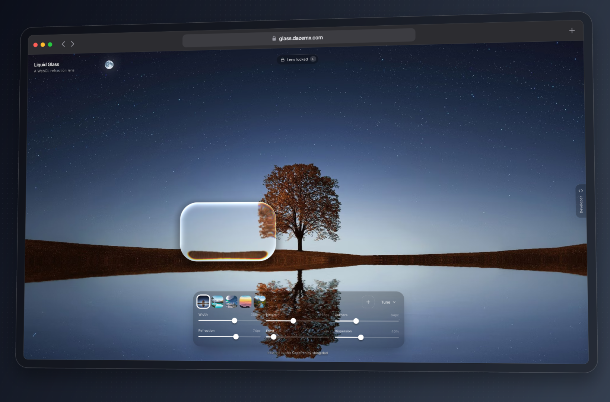

# Liquid Glass

A "liquid glass" lens that refracts, frosts and splits the light of real HTML behind it: text, buttons, inputs, images. Move your cursor (or drag on touch) and the lens follows with spring physics, stretching as it moves. Everything under it stays selectable and clickable.

Built with vanilla JavaScript, SVG filters, [Vite](https://vite.dev) and [Tailwind CSS](https://tailwindcss.com).



## Features

- Rounded-rectangle lens with a curved, refracting rim, over live HTML
- Frosted blur, chromatic dispersion, brightness and saturation, and a soft drop shadow
- Lighting: rim light, a Blinn-Phong specular highlight and a fresnel edge glow
- Adjustable bevel depth, from a thin rim to a full magnifying dome
- Five presets: Clear, Frosted, Dark, Prism and Dome
- Glass can also sit behind an element as its background (the demo's dock), and button mode makes it brighten on hover and flatten on press
- Spring-driven movement with squash and stretch, plus a press effect
- Press <kbd>L</kbd> to lock the lens in place (handy for screenshots)
- Live controls for shape, glass and light, grouped in tabs
- Built-in backgrounds, or upload / drag and drop your own image
- A liquid glass header that refracts the page as it scrolls under it
- The lens pops like a bubble when you scroll away from the hero, and swells back in when you return
- A code section that generates a drop-in snippet with your current settings
- Retina aware, touch friendly, keyboard nudging, respects `prefers-reduced-motion`

## How it works

`backdrop-filter: url(#svg-filter)` would refract whatever is behind an element, but only Chrome supports it. Instead, the lens holds a copy of the page, lined up with the original, and bends that copy with an SVG displacement filter. Plain `filter: url()` works in every browser. The displacement map and rim lighting are generated from a signed-distance rounded rectangle with a circular bevel.

The copy refreshes whenever the page changes (a `MutationObserver` plus input and scroll events). It is `inert` and `aria-hidden`, so it doesn't affect find-in-page, focus or screen readers.

Safari needs two workarounds, both handled in [`src/glass.js`](src/glass.js):

- It drops an SVG filter when the filtered content contains GPU-composited layers, so the copy has `backdrop-filter`, `will-change` and animations stripped.
- It scales transformed content inside an SVG filter wrongly on retina screens, so the copy is positioned with `left`/`top`, and zoom scales the filtered layer from outside.

Two details keep the refraction steady as the lens moves:

- Zoom isn't stored in the displacement map. Its channels are 8-bit, so a zoom stored there moved in half-pixel steps that swept across the content. The filtered layer is built at `1 / zoom` size and scaled up instead, so the map only holds the rim.
- The lens snaps to whole CSS pixels. Browsers rasterise filters on the CSS pixel grid, so at a fractional position the refraction is resampled and jumps against the settled frame.

The demo page has a longer, illustrated walkthrough in its "How it works" section.

## Browser support

Chrome, Firefox and Safari, on desktop and mobile.

Limitations of the copy: it doesn't show hover or focus states, `backdrop-filter` blur inside it is dropped (see above), and WebGL canvases and `<video>` aren't copied. IDs are removed from the copy so they stay unique, so style content inside the source with classes rather than `#id` selectors.

## Getting started

```sh
bun install
bun run dev
```

Then open the URL Vite prints. `bun run build` outputs a static site to `dist/`.

npm works too: `npm install && npm run dev`.

## Use it on your own site

Tune the lens on the demo, then scroll to the **Code** section to copy or download the snippet. It's an element to put your HTML in, plus a script with no dependencies and no build step.

If you use a bundler, copy [`src/glass.js`](src/glass.js) into your project instead:

```js
import { LiquidGlass } from "./glass.js";

// The lens refracts everything inside this element
const scene = document.querySelector("main");
const glass = new LiquidGlass(scene);

glass.set({ width: 280, height: 180, radius: 64 });

addEventListener("pointermove", (e) => glass.moveTo(e.clientX, e.clientY));
addEventListener("pointerdown", () => glass.press(true));
addEventListener("pointerup", () => glass.press(false));
```

To give an element a glass background instead, anchor the glass to it. Add `button: true` to make it respond to hover and press:

```js
new LiquidGlass(scene, { anchor: document.querySelector("#panel"), refraction: 12, chroma: 0 });
new LiquidGlass(scene, { anchor: document.querySelector("#play"), button: true });
```

Start from a preset and override what you like:

```js
const glass = new LiquidGlass(scene, { ...LiquidGlass.presets.frosted, frost: 8 });
glass.set(LiquidGlass.presets.dark);
```

### API

| Method | Description |
| --- | --- |
| `new LiquidGlass(source, options)` | Creates a lens over `source`. Options: `anchor` (an element to fill as its background), `container` (an element for the lens to live in, clipped to it), `button: true` (anchored glass responds to hover and press), `throttle` (re-copy a large source at most every this many ms), plus any parameters below. |
| `LiquidGlass.presets` | `clear`, `frosted`, `dark`, `prism` and `dome`, each a set of parameters. |
| `set(params)` | Updates any of the parameters below. |
| `moveTo(x, y)` | Moves the lens to a point in viewport (client) coordinates. |
| `press(down)` | Grows the lens slightly while `true`. |
| `show(visible, { pop })` | Fades the lens in or out. With `pop: true` it bursts like a bubble on the way out and swells back in. `moveTo` shows it again. |

| Parameter | Default | Description |
| --- | --- | --- |
| `width`, `height` | `280`, `180` | Lens size in CSS pixels (anchored glass takes its anchor's size) |
| `radius` | `64` | Corner radius in CSS pixels (anchored glass takes its anchor's) |
| `bevel` | `35` | How far the curved rim reaches in, in CSS pixels. At half the lens's smaller side or more, it's a full dome |
| `refraction` | `40` | How far the rim bends the content, in CSS pixels |
| `frost` | `2` | Blur radius in CSS pixels |
| `chroma` | `0.4` | Chromatic dispersion at the rim, `0` to `1` |
| `zoom` | `1.08` | Magnification across the whole lens |
| `specular` | `0.35` | Strength of the specular highlight, `0` to `1` |
| `fresnel` | `0.3` | Strength of the edge glow where the glass turns away, `0` to `1` |
| `brightness` | `0` | Brightness of what's seen through the glass, `-0.5` to `0.5` |
| `saturation` | `0` | Saturation of what's seen through the glass, `-1` (grey) to `1` |
| `tint` | `""` | A CSS colour laid over the glass, for legibility |
| `rim` | `1` | Strength of the rim lighting and edge hairline, `0` to `1` |

## Project structure

```
index.html          Page and UI markup (Tailwind)
src/glass.js        LiquidGlass: the copy, SVG filter, displacement map and spring physics
src/main.js         Demo UI: backgrounds, presets, sliders, pointer handling, page sections
src/developer.js    Developer panel and snippet generator
src/style.css       Tailwind entry and custom slider styles
```

## Credits

Inspired by [this CodePen by shingidad](https://codepen.io/shingidad/pen/jEPxMgW), which this project started as a rebuild of.

Lighting, tone, presets, the dome bevel and button mode are adapted from [ybouane/liquidglass](https://github.com/ybouane/liquidglass).

Background photos from [Pexels](https://www.pexels.com).
